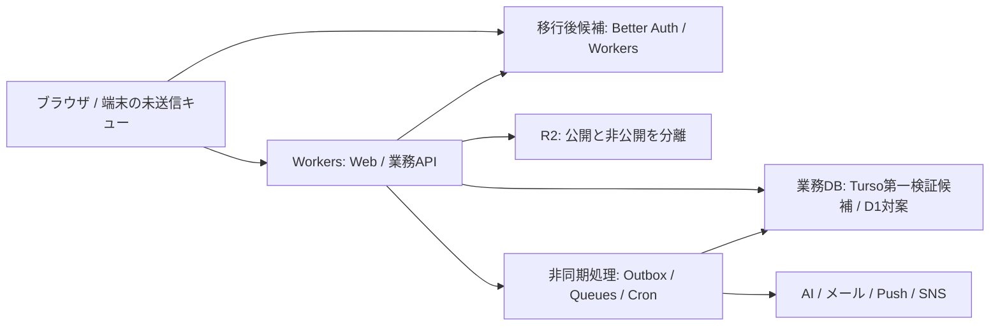

# 実行はWorkers、メディアはR2、認可はAPIの境界に置く

状態：段階移行の実装を開始。現在の本番構成は[全体図](../../../docs/architecture/system-overview.md)を正とする。
業務DBの候補と採用条件は[DB判断](database-decision.md)、移行順序は[計画](migration-plan.md)へ。

## 単独で運用でき、元へ戻せる構成を選ぶ

配置をCloudflareへ寄せても、機密データの境界と障害からの復旧方法を曖昧にしない。
Web・メディア・DB・認証を同時には替えず、各段階で原因を切り分けられるようにする。
DBの携帯性は、業務処理と認可をサーバーで扱い、製品固有部分を限定することで得る。
将来の全製品に対応する汎用ORMや抽象層を先に作らず、既存のデータ層を用途ごとに再利用する。

図は認証まで移した後の候補構成。中間段階はSupabase Authを残し、初期は現在の直アクセス/Edgeも維持する。
端末の水域Worker・画像WorkerはWeb Workerであり、Cloudflare Workersへの移設対象ではない。

## 認証は継続し、認可の責任を明示する

Web移行時はSupabase Auth・SSR Cookie・既存UIDを維持する。DB移行中もまずAuthを残す。
Supabase JWTを使う期間は署名・issuer・audience・有効期限を検証する。新認証ではDB sessionと現在の権限を検査する。
管理者は利用者が編集できない信頼済みの役割から判断し、`user_metadata`やリクエストの所有者IDを信じない。
失効・退会を機微な操作へ即時反映する方法を試験し、古いJWTだけで操作できる窓を放置しない。

RLS・列GRANTで担っていた制御は、用途別APIの認可・許可列・所有者条件へ移す。
公開レスポンスは公開用の型と列を明示し、管理者用オブジェクトを加工して流用しない。
Tursoトークン・D1管理権限・R2署名鍵はサーバー専用。ブラウザへSQL実行口を公開しない。
Cookie認証の更新APIにはCSRF/Origin検査を設け、認証エラー時は既定で拒否する。

Authを残すと `auth.users` と業務DBの間の外部キー・CASCADEは使えなくなる。
登録時のプロフィール作成は同じUIDで再実行可能にし、退会は新規操作の拒否→関連削除→メディア清掃→Auth削除の状態を記録する。
部分失敗は再試行できる削除ジョブで扱い、Authを消しただけで退会完了とはしない。
完全廃止の候補と条件は[認証設計](auth-design.md)・[認証切替](auth-cutover.md)で具体化した。採用は試作後に決める。
再認証と通常ログアウトの清掃を分け、移行による失効で端末の未送信記録を消さない。

## 業務の原子性をDB単位で守る

水域審査は原票・公開投影・監査を同じDBのトランザクションで確定する。
関連の強い表をまとめて移し、旧新DBをまたぐ外部キーや原子的更新を前提にしない。
行ロックやadvisory lockはそのまま移せない。条件付き更新・一意制約・バージョン検査で競合を防ぐ。
更新0件と権限拒否を成功にしない。公開座標・未確認と0件の区別・観察日と受付日時の区別を維持する。

副作用は業務更新と同じDB transactionでOutbox（未処理イベント表）へ記録し、commit後に配信する。
Queuesへの投入失敗は未送信Outboxの走査で回収し、更新の確定からイベント記録までの隙間を作らない。
消費側はイベントID・処理状態で重複を抑え、失敗は再試行・隔離・手動再実行できるようにする。
外部AIや通知の完了と投稿保存を分ける。外部送信の厳密な一度限りの実行は保証しない。
DB移行前は既存トリガーを正本とし、切替時に旧起動元を止めて二重通知を防ぐ。
全14処理は[移植対応表](background-processing.md)、認証/通知メールは[配信設計](email-design.md)に従う。

## メディアの公開性を保存先でも分ける

公開の `post-photos`・`post-audio` と、非公開の `rare-photos`・`water-report-photos` を分離する。
非公開R2は公開ドメインを接続せず、APIで所有者/管理者を確認して短命URLまたは認証配信を行う。
非公開レスポンスは共有キャッシュ禁止。公開写真にも元からある公開上の制約を確認する。
URLの一括文字列置換に頼らず、バケット・オブジェクトキー・公開区分を扱うメディア参照を設ける。
AI取得先は管理下のオブジェクトへ限定し、原本ハッシュ・サイズ制限・リダイレクト拒否を維持する。
R2と業務DBには分散トランザクションがないため、アップロード確定・孤立ファイル回収・削除再試行を設計する。
アップロードは実体の保存と照合後に参照/変更台帳を同時commitして受理し、失敗時の孤立実体は清掃する。
削除は参照/削除記録を同時commitし、実体削除を再試行する。切り戻しでも削除済みを再公開しない。

## Webランタイムは互換性試験で選ぶ

現行Next.js/webpackを維持するOpenNext案と、公式推奨のvinext案を小規模に比較する。
Node Proxy、Sentry、ISR、画像、Wasm、SW、独自manifest生成と容量予算が合格した案を採用する。
OpenNextの対応表だけで現行版の動作済みとはしない。詳細と根拠は[research.md](research.md)。

## 9：Web移行の実装契約

境界・依存・ファイル構成・9.1〜9.6の対応は[2026-11-14の実行契約](execution-20261114.md)に従う。
移植中の正本はSupabase/Vercelとし、Cloudflareの候補を実ランタイムで照合する。

## 9.7：追加課金なしの候補

R2は旧候補として保持する。[無料枠で停止する構成](zero-overage-execution-20261116.md)でD1 cacheとSQLite DOを試し、画面生成のCPU条件も照合する。
未確認のFree適用や機能縮小を前提にしない。業務DB/Auth/Storageの本番移送は含めない。
