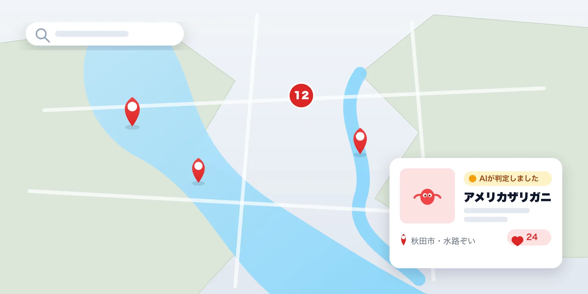

# ザリダス


**秋田の水辺で見つけた生きものを、地域の調査につながる記録へ。**
アメリカザリガニとウシガエルの観察を集め、地図で共有するWebアプリです。スマートフォンから記録し、ほかの人の観察や調査の呼びかけを見られます。

[アプリを開く](https://zaridasu.com/) · [画面と使い方](docs/screens/README.md) · [設計思想](README/08-design-philosophy.md) · [開発を始める](docs/oss/local-development.md) · [変更に参加する](CONTRIBUTING.md)



このリポジトリは、稼働中のザリダスのソースを公開するものです。履歴は持ち込まず、公開用に切り出した状態から始めています。由来と未確認事項は [公開の状況](docs/oss/release-status.md) に書きました。
ソースと表示確認用の代替画像を含み、本番の観察記録・写真・非公開地点を配布するものではありません。稼働中のサービスとは管理を分けています。

## 何ができる？

| やりたいこと | 使う画面 | できること |
|---|---|---|
| 参加企画や新しい記録を見たい | [ホーム](docs/screens/home.md) | バナー・クエスト・新着・保存した記録を見る |
| 近くの記録を知りたい | [地図・写真](docs/screens/map.md) | 場所・種類・期間で探し、観察の詳細を見る |
| 見つけたことを残したい | [投稿・詳細](docs/screens/posting.md) | 位置・日時・写真・音声などを記録する |
| 次に調べる場所を決めたい | [水域探索](docs/screens/water.md)、[調査計画](docs/screens/fieldwork.md) | 水辺の候補を探し、本人用の地点と調査結果を管理する |
| 調査に協力したい | [調査依頼](docs/screens/collaboration.md) | 依頼を探し、協力意思や観察結果を伝える |
| 活動を振り返りたい | [マイページ・図鑑](docs/screens/personal.md) | 投稿履歴、送信待ち、貢献の進み具合を見る |
| 地域全体の傾向を知りたい | [集計・公開データ](docs/screens/explore-and-data.md) | ランキング・推移・地域別の情報や配布データを見る |

閲覧から始められます。投稿や非公開スポットの保存にはログインが必要です。ホームのしおりは端末内に保存します。各画面の入口と利用条件は [全画面の一覧](docs/screens/routes.md) へ。

## なぜ、この設計なのか

- **気軽に参加できること。** 地図の閲覧から始め、投稿・調査・継続へ少しずつ進めます。
- **記録を増やすことと、記録の質を分けて考えること。** 審査、写真・音声、調査方法、貢献の多様性を組み合わせます。
- **場所を守ること。** 外来種の公開位置は粗化が既定。本人用の場所・調査計画・希少種記録は公開投稿と分けます。
- **分からないことを、分からないまま伝えること。** 地図に点が無いことを「生きものがいない」とは扱いません。

画面との対応は [設計思想と利用体験](README/08-design-philosophy.md)、実装上の判断は [設計とコードの案内](docs/architecture/README.md) を参照してください。

## 開発環境で動かす

CIと同じ **Node.js 22**、npm、Supabase CLI v2、Docker互換環境を使います。リポジトリをcloneし、Docker互換環境を起動してください。

```sh
git clone https://github.com/haranishi/zaridasu-oss.git
cd zaridasu-oss
npm ci
npm run local:start
npm run setup:local
npm run seed:local
npm run dev
```

`http://localhost:3000` を開きます。`setup:local` はローカル接続用の `.env.local` を作り、`seed:local` は架空データだけを投入します。本番の接続先やキーは使いません。
初期化の条件と検証は [ローカル開発](docs/oss/local-development.md)、任意の外部連携は [セットアップ](README/03-setup.md) へ。
Next.js・React・TypeScript、Supabase、Leafletを中心に構成し、水域の計算にはRust/Wasmも使います。[機能と技術](README/02-features-and-stack.md)

## 目的に合わせて読む

| 知りたいこと | 入口 |
|---|---|
| 各画面で何ができ、どこへ進むか | [画面ガイド](docs/screens/README.md) |
| 目的・設計思想・研究の位置づけ | [設計思想](README/08-design-philosophy.md)、[研究背景](README/01-research-context.md) |
| コードの意味・全体構成・主要処理 | [設計ガイド](docs/architecture/README.md)、[797ファイルの索引](docs/architecture/source-map.md) |
| 今の仕様・変更の履歴 | [現行仕様](docs/current/README.md)、[文書台帳](docs/README.md) |
| 環境変数・実行コマンド・検証 | [設定とスクリプト](README/04-env-and-scripts.md)、[E2Eと配置](README/05-e2e-and-directory-structure.md) |
| DB・Edge Functions・本番運用 | [運用文書の入口](README/06-docs-and-edge-functions.md)、[配備と権利表示](README/07-security-deploy-license.md) |
| 修正を提案する・エージェントで開発する | [参加ガイド](CONTRIBUTING.md)、[cc-sddの進め方](.kiro/README.md) |

## 公開の範囲と参加

本番データと資格情報を配布せずに参加するための[公開範囲・開発環境・公開手順](docs/oss/README.md)があります。
このリポジトリの `main` はリリース用、`develop` はソースの統合先です。自動配備は行わず、参加者のPRから本番へ配備できません。
公開の経緯と確認の結果は [公開の状況](docs/oss/release-status.md) に記録しています。

## ライセンス

コードは [MIT](LICENSE)。公開データセットは別途CC BY 4.0の条件で提供し、このリポジトリはそのデータエクスポートではありません。[データ公開の手順](docs/runbooks/open-data-doi.md) と [第三者素材の権利表示](THIRD_PARTY_NOTICES.md) も確認してください。
