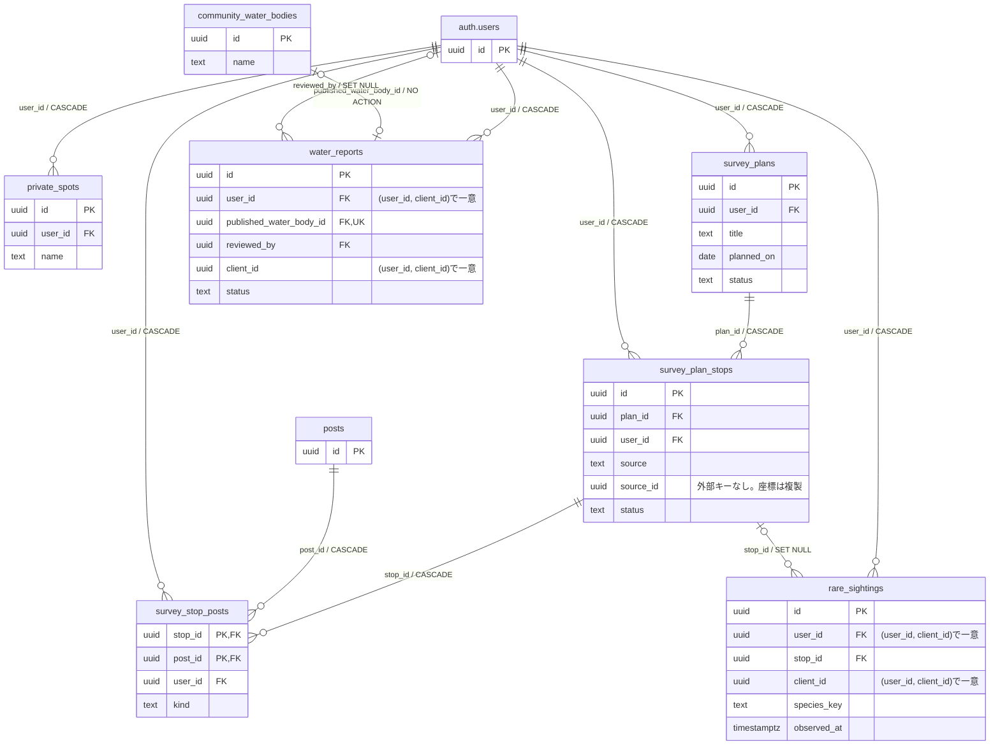

# 現地調査は、計画から地点、結果へと本人の表をたどる

[ER図の全体](data-model-er.md)のうち、非公開の現地調査・個人の場所・水域の情報提供を列つきで描く。
主キー(PK)・外部キー(FK)・一意(UK)と、役割の分かる列だけを載せる。全列は [schema.sql](../../supabase/schema.sql) を読む。

## 読むときの注意

- 計画を消すと地点も消える。地点を消すと、地点と投稿のリンク(`survey_stop_posts`)は消え、希少種(`rare_sightings`)は残って`stop_id`だけが空になる。
- `survey_plan_stops.source_id`は外部キーではない。元の場所の座標を複製して持つので、元を消しても計画は残る。
- `survey_stop_posts`の主キーは`(stop_id, post_id)`で、同じ地点に同じ投稿を2回結べない。
- `rare_sightings`は`posts`と結ばない。公開の投稿・写真・コメントの経路へ混ぜないため。`(user_id, client_id)`が一意で、端末からの再送が二重にならない。
- `water_reports.published_water_body_id`は一意で、公開表に載るまではnull。公開表の`community_water_bodies`は提出者・メモ・写真を持たない。
- 非公開の写真は表でなく、Storageの`rare-photos`・`water-report-photos`に置く。行を消しても写真の実体は消えない（[データモデル](data-model.md)）。
