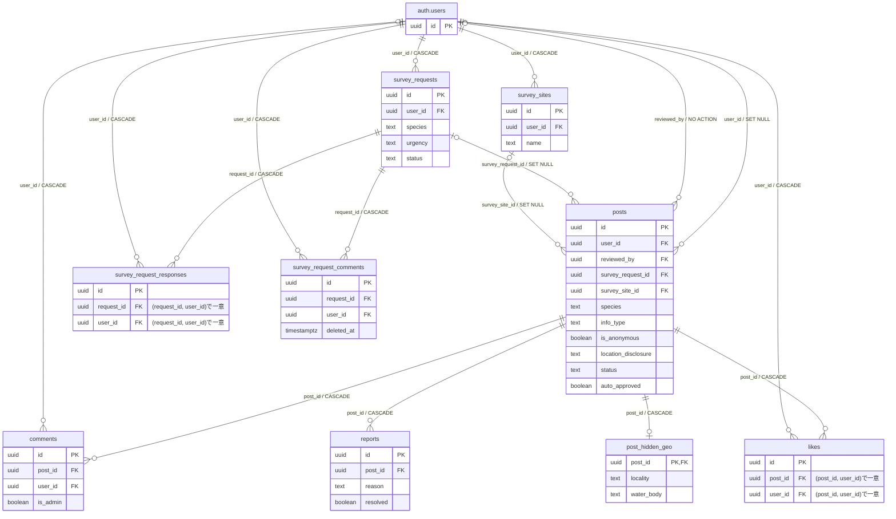

# 公開の記録は投稿に集まり、反応・通報・調査依頼が結び付く

[ER図の全体](data-model-er.md)のうち、公開の投稿と、それに結び付く表を列つきで描く。
主キー(PK)・外部キー(FK)・一意(UK)と、役割の分かる列だけを載せる。全列は [schema.sql](../../supabase/schema.sql) を読む。

## 読むときの注意

- `posts.user_id`は匿名投稿のためnullを許す。`is_anonymous`がfalseなら`user_id`は必須（CHECK `chk_user_id_required`）。
- `posts.survey_request_id`は調査依頼への結果投稿、`survey_site_id`は本人の定点を指す。どちらも親を消すと空になるだけで、投稿は残る。
- `likes`は同じ利用者が同じ投稿に1回だけ、`survey_request_responses`は同じ利用者が同じ依頼に1回だけ結べる。
- `reports`は利用者に結び付かず、`reporter_ip`だけを持つ。
- `post_hidden_geo`は投稿1件につき0か1行で、位置を非公開にした投稿の細かな地名を退避する。
- 誰が何を読めるかは、図ではなく [認可](authorization.md) で決まる。
