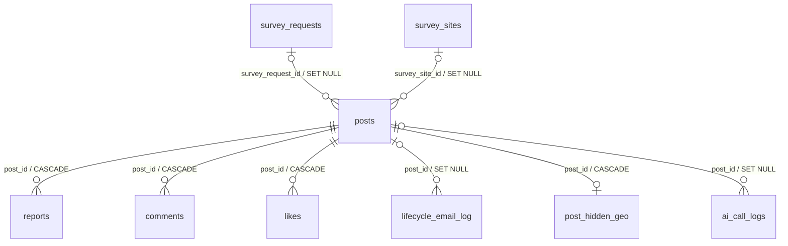
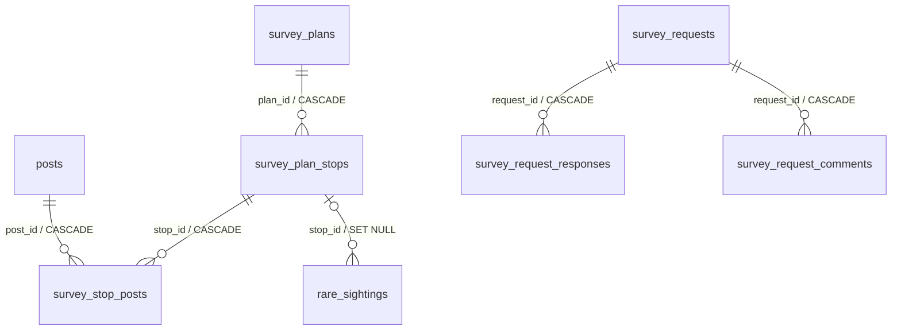
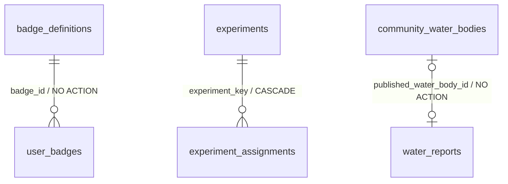

# ER図は、投稿と利用者を中心に33の表を外部キー42本でつなぐ

[データモデル](data-model.md)の関係図は、業務上のつながりだけを示す。ここでは、SQLの外部キーの向きと、親を消したときの動きを図にする。
列の一覧は [schema.sql](../../supabase/schema.sql) を読む。列つきの図は [公開の記録](data-model-er-public.md) と [現地調査と水域](data-model-er-fieldwork.md) にある。

## 根拠と読み方

調査基点は`develop`の`305c718`、確認日は2026-10-21。`schema.sql`を土台に、migrations 67本をファイル名順に重ねた形から、表と外部キーを取り出した。
別のSQL構文解析器でも読み直し、表33・外部キー42・主キー・一意・削除時の動きが一致した。本番DBとは照合していない。

- 線は親表から子表へ引く。親側の`||`は必ず1つ、`|o`は0か1つ。子側の`o{`は0以上、`o|`は0か1つ。
- 線の文字は「外部キーの列 / 親を消したときの動き」。`CASCADE`は子も消え、`SET NULL`は子を残して参照だけ空にし、`NO ACTION`は子が残る間は親を消せない。

## 表どうしの外部キーは17本で、投稿が中心になる

投稿に直接つながる8本。

調査依頼と調査計画の6本。

どこにもつながらない3組（バッジ・実験・水域の公開）。

投稿(`posts`)を親にする関係は7本ある。コメント・いいね・通報・隠した地名・地点とのリンクは投稿と一緒に消え、配信履歴とAI呼び出しの記録は残って投稿への参照だけが空になる。
調査依頼(`survey_requests`)を消すと、応答とコメントは消える。結果の投稿は残り、`survey_request_id`だけが空になる。

## 利用者(auth.users)を消したときの動きは3通りある

利用者への外部キーは25本ある。

| 動き | 表.列 |
|---|---|
| 子も消える（`CASCADE`）19本 | `comments.user_id`、`likes.user_id`、`user_profiles.id`、`user_badges.user_id`、`user_progress.user_id`、`user_collection.user_id`、`survey_requests.user_id`、`experiment_assignments.user_id`、`survey_sites.user_id`、`push_subscriptions.user_id`、`user_onboarding.user_id`、`private_spots.user_id`、`survey_plans.user_id`、`survey_plan_stops.user_id`、`survey_stop_posts.user_id`、`rare_sightings.user_id`、`water_reports.user_id`、`survey_request_responses.user_id`、`survey_request_comments.user_id` |
| 子を残して参照を空にする（`SET NULL`）3本 | `posts.user_id`、`lifecycle_email_log.user_id`、`water_reports.reviewed_by` |
| 子が残る間は消せない（`NO ACTION`）3本 | `posts.reviewed_by`、`species_location_defaults.updated_by`、`audit_logs.admin_id` |

公開した投稿(`posts.user_id`)は、利用者を消しても残り、投稿者との結び付きだけが外れる。
`NO ACTION`の3本は審査者・更新者・管理者の記録で、参照が残る間はDBが利用者の削除を断る。退会の流れは [認証](authentication.md) を読む。

## 図に出てこない12表

| 種類 | 表 |
|---|---|
| 利用者にだけ結び付く8表 | `user_profiles`、`user_onboarding`、`user_progress`、`user_collection`、`push_subscriptions`、`private_spots`、`species_location_defaults`、`audit_logs` |
| 外部キーを持たない4表 | `admin_alerts`、`admin_login_attempts`、`ai_cache_registry`、`geo_cache` |

## 外部キーで結んでいない関係

- `survey_plan_stops.source_id`は、元の場所の座標を複製して持つ。元を消しても計画を残すため（[データモデル](data-model.md)）。
- `rare_sightings`は`posts`と結ばない。希少種を公開の経路へ混ぜないため、別の表で持つ。
- `community_water_bodies`は提出者・メモ・写真の列を持たず、`water_reports`が一方向に指す。
- `audit_logs.target_id`は、`target_type`（`post`・`comment`・`report`・`user`）と組で対象を指す。
- 種(`species`)は`posts`・`user_collection`・`species_location_defaults`のどれも文字列で持ち、表では結ばない。

## schema.sqlとmigrationsの食い違い

両者は一致しない（背景は [migrations 一覧](../../supabase/migrations/README.md) の「from-scratch 再適用」）。この図では次のように扱った。

- `comments.user_id`は、`schema.sql`が`SET NULL`、`20260323000001`が`CASCADE`。後に適用されるmigrationの`CASCADE`を採った。`delete_own_account`の注記は「匿名化」と書いており、migrationと合わない。CIの`rls-tests`は`schema.sql`を適用して試験するので、この列はCIでは`SET NULL`になる。
- `posts.audio_url`と`posts.survey_request_id`は、`schema.sql`にだけ定義がある。migrationsはこの列を参照するが、足す文は無い。
- 表5つ（`admin_alerts`・`ai_cache_registry`・`ai_call_logs`・`survey_request_comments`・`survey_request_responses`）は、migrationsにだけ定義がある。

## 更新するとき

表・外部キー・削除時の動きを変える変更では、このページと領域別の図を同じ変更で直す。列の追加だけなら、図に載せた列に当たるときだけ直す。
