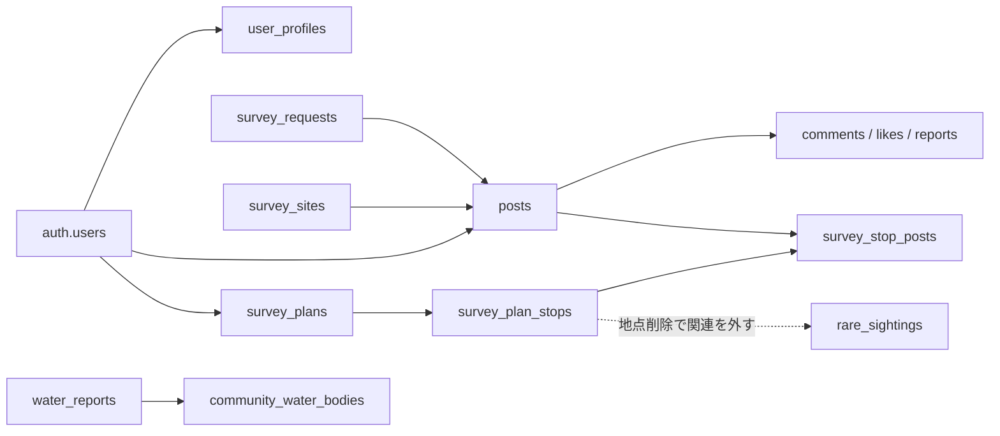

# データは公開記録・個人の調査・運用の3領域に分ける

対象は、画面からDBまでの関係を調べる開発者。最初に本ページと[権限](authorization.md)を読み、変更する領域の説明へ進む。
2026-10-17のローカルコードを根拠にする。本番の表・権限・データは今回照合していない。

## スキーマとmigrationを合わせて現在の構造を読む

[schema.sql](../../supabase/schema.sql)は主要な定義をまとめたファイル、[migrations](../../supabase/migrations/README.md)は既存環境へ順に適用する変更である。
`ai_cache_registry`・`ai_call_logs`・`admin_alerts`・調査依頼の応答／コメントなど、migration側に定義がある表もある。schema.sqlだけでDB全体を判断しない。
同じ関数が複数回定義されるので、最初の定義ではなく後続の置換と追補を確認する。適用済みmigrationは書き換えず、新しい変更を足す。

[database.types.ts](../../src/types/database.types.ts)はアプリが使うDB境界の型で、全DBオブジェクトの台帳ではない。通常はschemaとmigrationから手で同期し、`schema:check`と`type-check`で照合する運用である。
適用履歴の文書と、実際のDBに適用されているかの確認も分ける（[migration運用](../../supabase/migrations/README/03-operating-rules.md)）。

## 公開の中心はposts、個人の調査は別表に置く

| 領域 | 主な表 | 関係と役割 |
| --- | --- | --- |
| 本人情報 | `auth.users`、`user_profiles`、`user_onboarding` | 認証と公開プロフィールを分離。通知設定と開始手順の進捗は本人に結び付く |
| 観察 | `posts`、`species_location_defaults`、`post_hidden_geo` | 外来種の記録・審査・公開位置。位置非公開時の細かな地名は別表へ退避 |
| 交流・審査 | `comments`、`likes`、`reports`、`audit_logs` | 投稿への反応、通報、管理操作の証跡。公開範囲は表ごとに異なる |
| 調査の募集 | `survey_requests`、`survey_request_responses`、`survey_request_comments` | 「探してほしい依頼」と協力意思・会話。結果投稿とは外部キーで結ぶ |
| 定点調査 | `survey_sites` | 本人の定点。`posts.survey_site_id`と調査方法で研究用に区別する |
| 個人の場所 | `private_spots` | 名前付きの非公開保存。公開投稿として扱わない |
| 現地調査 | `survey_plans`、`survey_plan_stops`、`survey_stop_posts`、`rare_sightings` | 計画・地点・結果へのリンク・希少種。公開集計の経路から分離する |
| 水域の情報提供 | `water_reports`、`community_water_bodies` | 非公開の情報提供を審査し、確認済みの名前と粗化座標だけを公開表へ投影 |
| 貢献・研究 | バッジ、進行、コレクション、実験の各表 | [研究集計と貢献の説明](data-model-research.md)を参照 |
| 非同期運用 | AIログ・キャッシュ、地名キャッシュ、配信履歴、Push購読、管理警告・ログイン試行 | [Edge Functions](edge-functions.md)と[通知](notifications-ai.md)を参照 |

矢印は業務上のつながりを示す。外部キーの向きと、親を消したときの動きは [ER図](data-model-er.md) を読む。

## 同じ「位置」に見えても、保存目的と公開契約が異なる

`posts`は観察の記録、`private_spots`は個人の場所、`survey_plan_stops`は予定日の行動地点である。
計画の地点は元の場所の座標を複製し、`source_id`を外部キーにしない。元のスポットを消しても計画を維持するための設計である（[fieldwork](fieldwork.md)）。
`rare_sightings`をpostsへ混ぜない理由は、公開RPC・写真・コメント・いいねの各経路に除外条件を追加し続ける事故を避けるためで、[現行仕様](../current/fieldwork.md)に記録されている。

水域の情報提供は別の公開境界を持つ。[水域migration](../../supabase/migrations/20261008100350_water_discovery_reports.sql)の`review_water_report`が行をロックし、採否・公開表・監査を同じトランザクションで更新する。
公開表に提出者、メモ、写真参照を持たせない。却下・取り下げ・退会による元行削除では公開投影も消す。水域の取得・形状は[水域処理](water-geometry.md)へ進む。

## DB行と写真・音声の実体は別の寿命を持つ

| 保存先 | 公開性と使い道 |
| --- | --- |
| `post-photos`、`post-audio` | 公開メディア。投稿行の審査・位置非公開だけでファイル自体は非公開にならない |
| `rare-photos` | 希少種の非公開写真。本人／管理者の署名URLで表示 |
| `water-report-photos` | 情報提供の非公開写真。採用後も公開写真へ移さない |
| `social-announce-state`等の設定先 | SNS告知の重複を避けるmarker。観察データではない |

行の削除によるCASCADEはStorageの実体を消さない。[投稿](posting-moderation.md)と[現地調査](fieldwork.md)の削除手順をそれぞれ使う。
`delete_own_account`は認証利用者を削除し、関連表はCASCADEまたはSET NULLに従う。写真の片付けと端末データの削除は[認証処理](authentication.md)の責務である。

## 変更時は型・権限・公開経路を一緒に確かめる

列追加は、DB型だけでなく公開SELECT・CSV・RPC・保護トリガーにも影響する。座標や運用列は「型があるから取得できる」と考えない。
検証の入口は[validation](validation.md)。権限は[SQLテスト](../../supabase/tests)、非公開表の公開経路混入は`private-tables:check`、配布列は[データセットのテスト](../../src/app/dataset/zaridasu.csv/__tests__/route.test.ts)が担当する。
表の変更履歴は既存REQに残し、現在の利用者向け挙動は[docs/current](../current/README.md)を更新する。新しい設計判断の扱いは[cc-sdd運用](../../.kiro/README.md)に従う。
