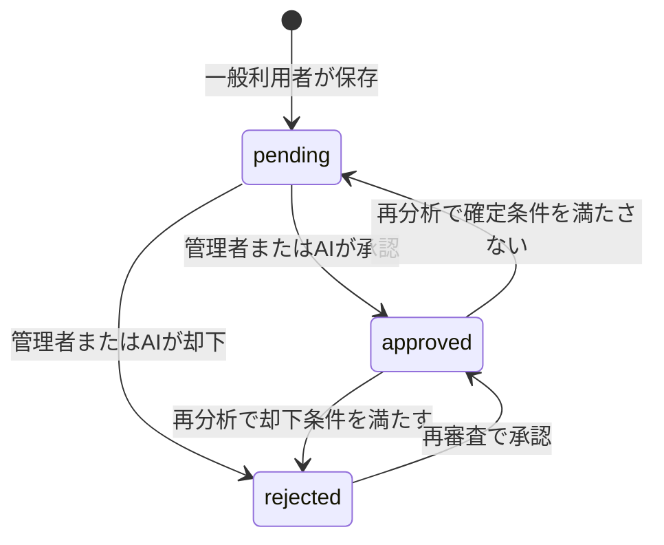

# 投稿は保存・審査・公開を別の段階として扱う

投稿がDBに保存されたことと、誰にでも公開されたことは異なる。通常の投稿と圏外からの再送は同じINSERTを通し、公開可否はDBと審査処理で決める。
利用者向けの挙動は[現行投稿仕様](../current/posts.md)、地図での表示は[map-posts](map-posts.md)、再送全体は[offline](offline.md)にある。

## 送信する列の組を1か所で作る

| 段階 | コードの責務 |
| --- | --- |
| 入力・メディア | [usePostForm](../../src/hooks/posts/usePostForm.ts)が検証、写真・音声のアップロード、DB失敗時の片付けを進める |
| 値の正規化 | [posts-write](../../src/lib/data/posts-write.ts)の`postFieldsFromForm`／`postFieldsFromPending`が文字列・古い下書きを共通の入力へ直す |
| INSERT行 | `buildPostInsertRow`が画像hash・実験割付・調査方法・位置非公開などを組み、`insertPost`がidを返す |
| DB保護 | RLSで本人のINSERTに限定し、トリガーが審査・運用列と公開位置を確定する |
| 非同期処理 | DBトリガーからAI分析・地名付与へ進む。ブラウザの完了待ちにはしない |

通常と再送で別々にINSERT行を手書きした時期に、再送側だけhash・実験割付が欠けたため集約した（REQ-331、[列一致テスト](../../src/lib/data/__tests__/posts-write.insert.test.ts)）。
新しいフィールドはこの共通入力に追加する。新規投稿の3本目のINSERTや、送信後のブラウザからのAI初回invokeを増やさない。

写真は[imageProcessor](../../src/lib/imageProcessor.ts)がEXIFを除き、長辺1280pxのJPEGへ処理する。公開写真から撮影位置を漏らさないための前処理である。
`is_anonymous`は作者名の表示設定であり、ログイン不要投稿を表す値ではない。現在のINSERT経路はログインを必要とする。

## pendingから管理者またはAIが審査する

一般利用者のINSERTは、画面が別のstatusを送っても`protect_post_insert_columns`で`pending`になる。不在確認も同じで、管理者の投稿だけは送った承認値が通る。
公開読取の基準は[posts.ts](../../src/lib/data/posts.ts)の`PUBLIC_POST_STATUS`。RLSでは本人と管理者が非公開状態も読める。

AIは実際にstatusを更新する。[analyze-image](../../supabase/functions/analyze-image/index.ts)と[analyze-audio](../../supabase/functions/analyze-audio/index.ts)がservice-roleで自動承認・却下する条件を持つ。
判定不能・API停止と低信頼度を、承認とみなさない。条件と既知の並行更新の制約は[AI分析](notifications-ai-analysis.md)を読む。

管理者の操作は[posts-admin](../../src/lib/data/posts-admin.ts)に集め、承認・却下に`reviewed_at`と`reviewed_by`を付ける。
公式フラグ・承認・却下・削除はいずれも返ったidを確認し、0行なら権限不足または対象消失として失敗にする。RLS拒否を成功と表示しないためである。
本人の編集は[posts-write](../../src/lib/data/posts-write.ts)を使い、審査・AI・観測時の保護列はDBトリガーで旧値へ戻す。

## コメントといいねは投稿の審査状態を引き継がない

[schema.sql](../../supabase/schema.sql)のcomments／likesは公開SELECTを持つ。コメントはログイン本人が作成し、本人が削除でき、管理者の削除経路もある。`is_admin`の偽装はINSERTトリガーで防ぐ。
いいねは`(post_id, user_id)`を一意にする。コメント・いいねにはDBで利用者ごとの連投制限がある。
これらの公開範囲はpostsの`approved`条件を自動では継承しない。希少種など非公開記録をpostsへ入れると、この交流経路にも公開対策が必要になる。
コメント保存後の通知は[notify-comment](../../supabase/functions/notify-comment/index.ts)を呼び、実在する自分のcomment_idからDBの本文を取り直す。通知失敗は保存済みのコメントを取り消さない。

## 通報は注意フラグを立て、公開停止はしない

通報理由はspam／wrong_location／inappropriate／other。誰でもINSERTでき、閲覧・解決は管理者に限る。
`set_report_reporter_ip`はクライアントのIP申告を破棄し、DBが観測した値で記録する。IP列は列権限で公開読取から外し、通報数とIPごとの上限をDBで検査する。
未解決通報が3件になると`flag_post_on_reports`が`is_flagged`を立てる。これは審査の注意表示で、statusを変えて自動非公開にはしない。

## 監査と削除には部分完了がある

[writeAuditLog](../../src/lib/auditLog.ts)は管理画面からの監査INSERTで、記録失敗をログへ出して操作本体は止めない。DBにもstatus変更・削除の監査トリガーがあり、[migration](../../supabase/migrations/20260513000003_audit_logs_check_extend_and_delete_trigger_defensive.sql)で防御的に扱う。
すべての監査が非同期・任意ではない。水域審査RPCは公開表と監査を同じトランザクションで更新する（[data-model](data-model.md)）。

DBのCASCADEはコメント・いいね・通報行を消すが、写真・音声の実体を消さない。
[useDeletePost](../../src/hooks/posts/useDeletePost.ts)は写真を先に削除し、失敗なら投稿削除を止める。その後DB削除が失敗すれば写真だけ消えた状態になり得る。現実装ではこのフックから音声削除を呼んでいない。
StorageとDBを1つのトランザクションとして説明しない。管理画面側を含む削除の検査では、残存ファイルと部分完了を分けて確認する。

変更時の検証は[posts-writeテスト](../../src/lib/data/__tests__/posts-write.test.ts)・[管理投稿フックのテスト](../../src/hooks/admin/__tests__/useAdminPosts.test.ts)と、[rls_posts](../../supabase/tests/rls_posts.sql)・[rls_reports](../../supabase/tests/rls_reports.sql)・[rls_storage](../../supabase/tests/rls_storage.sql)を入口にする。
審査状態・座標・通知は別の契約なので、関連する[権限](authorization.md)・[通知](notifications-ai.md)の検査も選ぶ。本ページはローカル実装の説明で、今回の実配信や本番操作の成功を示すものではない。
