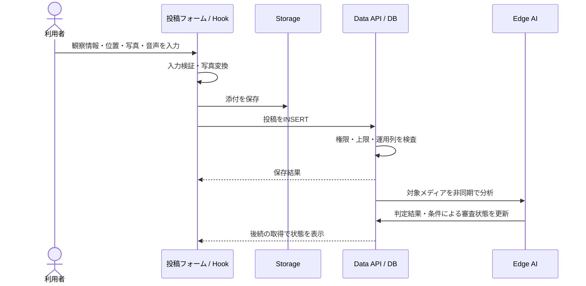

# 主要な処理をたどる

ここでは入口から保存・表示までをつなぐ。各モジュールの詳細と例外はリンク先を参照する。

## 地図を開き、公開記録を見る

`app/(home)/page.tsx` → `HomeShell` → `views/HomePage.tsx` → 地図・一覧の部品。
公開取得は [posts.ts](../../src/lib/data/posts.ts) などを通り、承認状態と公開用座標を選ぶ。
地図の表示範囲・絞り込みと、DBが許可する情報の範囲は別の責任。[地図と投稿](map-posts.md) を参照する。
非公開位置をnullから0へ補正したり、本人用の座標取得へ置き換えたりしない。

## 記録を投稿し、審査する

初期投稿は審査待ち。クライアントが送った承認・運営用の値はDBで保護する。
AIは条件次第で自動承認・却下し、判定不能や画像・音声の矛盾等を手動判断へ残す。
添付とDBは1トランザクションではない。途中失敗や削除時の制約も [投稿と審査](posting-moderation.md)、[AI分析](notifications-ai-analysis.md) に記載した。

## 認証して初回案内を終える

認証UI → Supabase Auth → callback／AuthProvider → 必要ならOnboardingGate → 4画面の案内。
一般の案内、登録直後の必須案内、メニューからの再表示は開始条件が異なる。
案内の保存先と失敗時の扱いは [認証](authentication.md)、各入口は [introduction](../current/introduction.md) を読む。
画面の案内を終えたこと自体は、DBの管理権限や投稿の承認を与えない。

## 水域を探す

地図の周辺検索 → Next.jsの `/api/nearby-water` → 水域データ取得 → 候補を計算 → 公開記録を関連付け → パネル表示。
計算量に応じてJavaScriptまたはWorker＋Wasmを使い、利用できない経路は代替する。
古い検索の完了を新しい表示へ混ぜず、集計不能と0件を区別する。[水域](water-geometry.md) を参照する。

## 調査計画と希少種を扱う

地図の地点 → fieldworkの計画・立寄り先 → 現地の位置条件を確認 → 発見／不在／希少種の記録。
通常投稿へつなぐ記録も、本人だけの計画・希少種の記録もある。公開用の投稿一覧と同じクエリにはまとめない。
オフライン時は所有者を含めて端末へ保持し、再送・ログアウト・別利用者への切替を管理する。[fieldwork](fieldwork.md) を参照する。

## 公開データを配布し、通知を届ける

CSV・GeoJSONは匿名の公開取得から承認済み情報を選び、さらに位置を粗化して配布する。[公開データ](dataset-surveys.md) を参照する。
審査・コメント・調査依頼・研究採用などの通知には別々の起動元と配信条件がある。[通知](notifications-ai.md) を参照する。
取得・保存・審査・配信のどこが成功したかを分けて確認する。
