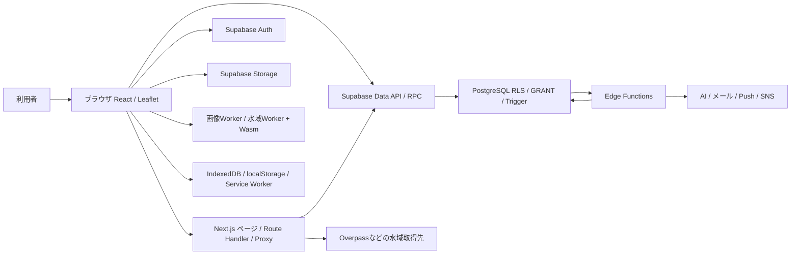

# システム全体と実行場所

中心はNext.js App Routerの画面とSupabaseのデータ基盤。
ブラウザからDBへ直接アクセスする経路が多く、すべての処理がNext.jsのAPIを通る構成ではない。

## 各層の責任

| 場所 | 主な責任 | 詳細 |
|---|---|---|
| `src/app` | URL、レイアウト、メタデータ、サーバー側取得、HTTPレスポンス | [フロントエンド](frontend.md) |
| `src/views` | ページ本体、画面内の操作と状態の接続 | [地図と投稿](map-posts.md)、[参加機能](participation.md) |
| `src/components` | 再利用するUI、認証・投稿・地図などの部品 | [共通UI](localization-ui.md) |
| `src/hooks`・`src/context` | 取得・操作の状態、ログインや設定の共有 | [認証](authentication.md) |
| `src/lib`・`src/types` | 共有データアクセス、変換、検証、型 | [共通コード](shared-code.md) |
| `src/features/fieldwork` | 非公開調査のUI・保存・再送をまとめた境界 | [フィールドワーク](fieldwork.md) |
| `src/features/water`・`rust` | 水域探索、候補計算、報告とWasm | [水域](water-geometry.md) |
| `supabase` | スキーマ、権限、トリガー、RPC、Edge Functions | [データモデル](data-model.md) |
| `scripts`・`.github` | 生成、検査、デプロイの前提、バックアップ | [運用](operations-ci.md) |

## 3種類のSupabaseクライアント

- [client.ts](../../src/lib/supabase/client.ts)：ブラウザの共有クライアント。ログインした人のJWTとDB権限に従う。
- [server.ts](../../src/lib/supabase/server.ts)：サーバーでCookieを読み、利用者のセッションを引き継ぐ。
- [anon.ts](../../src/lib/supabase/anon.ts)：Cookieに依存しない公開取得用。閲覧者本人の特権を混ぜず、公開ページやデータ配布に使う。

Edge側の管理クライアントは別物。service roleはRLSを迂回できるため、[Edge入口の検証](edge-functions.md) が必要。
公開設定としてブラウザへ渡すキーと、Edgeの秘密情報を交換してはいけない。

## HTTPとバックグラウンド処理

Route Handlerには水域検索、OG画像、CSV・GeoJSON配布がある。公開ページにもサーバー取得がある。
投稿に伴うAI判定や通知は、DBトリガー等からEdgeを呼ぶ経路を持つ。画面の保存完了と外部処理完了は同時ではない。
認可は [authorization](authorization.md)、失敗・再試行は領域ごとの文書を読む。

## ビルドと本番反映は別の境界

Webのビルドが成功しても、DBのmigrationやEdgeの変更が適用されたことにはならない。
PRの検査、mainのWebデプロイ、DB・Edgeの適用手順は [運用](operations-ci.md) にまとめた。
このガイドはリポジトリ内の構成を説明し、本番への適用状況は記録していない。
