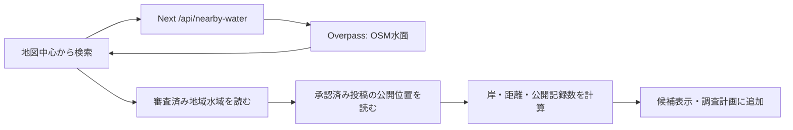

# 水域を探し、公開記録と照合する

水域機能は、OSMの水面と審査済みの地域情報から調査候補を作る。
公開記録が見つからない場所を示すが、未調査や生物の不在を証明するものではない。
本ページは現行コードの責務を説明する。画面の仕様は[水域README](../../src/features/water/README.md)、投稿側は[地図・投稿](map-posts.md)を参照する。

## 検索はサーバーの取得とブラウザの照合に分かれる

[NearbyWaterLayer](../../src/features/water/components/NearbyWaterLayer.tsx)が取得・選択・中断を持つ。
OSMの成功結果を先に表示し、その後に地域水域と公開投稿を読み、候補を更新する。
ホームの種・期間フィルターから独立して照合し、公開記録の取得失敗でも水面は残す。
再検索・アンマウントではAbortControllerと要求の同一性確認で古い結果の反映を防ぐ。
計算の高速化は[WorkerとRust](water-geometry-wasm.md)に分離する。

## Overpassを同一オリジンのAPIで囲う

[route.ts](../../src/app/api/nearby-water/route.ts)には、CSPの外部接続先を増やさず、上流への負荷を集約する理由が記録されている。
日本の範囲外や不正座標は400。半径は100〜3000m、既定1500mに制限する。
`natural=water`・旧`landuse=reservoir`のway/relationと、中心を含む水面を検索する。河川の線形は対象外。
分割された外周・内周を組み立て、閉じない断片を捨て、島を穴として残す。
返却は最大200件のPolygon/MultiPolygon、識別子、表示名に絞る。

| 保護・失敗 | 現行の扱い |
|---|---|
| 上流障害 | 2取得先を順に試す。各fetchは12秒、Overpassクエリは8秒 |
| HTTP 200内の不完全応答 | `remark`や不正本文を失敗と扱い、次の取得先へ進む |
| 正常な0件 | 成功として返し、次の取得先へ再照会しない |
| 全取得先の失敗 | 200＋空features＋`meta.degraded=true`。`no-store` |
| 連続検索 | 座標小数3桁＋半径で5分キャッシュ。同じ処理を`inFlight`で共有 |
| メモリ上限 | 最大128キー。サーバーレスのインスタンス間では共有しない |
| CDN | 成功時のみ`s-maxage=300`、`stale-while-revalidate=600` |

これは利用者ごとの厳密な分散レート制限ではない。上流データの網羅性も保証しない。

## 「公開記録なし」は完全に取得できたときだけ出す

[publicData.ts](../../src/features/water/data/publicData.ts)は、`status=approved`の`display_lat/display_lng`だけを読む。
正確な投稿位置、非公開調査、希少種記録を計算へ渡さない。地域水域は公開専用表から最大200件を読む。
公開投稿は最大1000件。DBのexact count、返却行数、有効位置の件数が一致した場合だけ`complete=true`とする。
ちょうど1000件で全件有効なら完全取得。上限超過、件数欠落、不正位置、取得失敗は不明扱いとなる。

[candidates.ts](../../src/features/water/lib/candidates.ts)が外接矩形、最近傍の岸、距離、記録数を計算する。
水面の内部は距離0、内周の陸地は水面に含めない。岸から150m以内の公開位置も数える。
150mは公開位置の粗化を吸収するための余白で、道路・進入可否を保証する経路距離ではない。
計画へ渡す位置は湖の重心でなく、検索時の中心に近い岸の目安。地図移動後も保持する。
名称をLeafletのHTMLポップアップへ渡す前にエスケープする。

## 水域の投稿は非公開の原票から審査済み投影を作る

| 層 | 責務と入口 |
|---|---|
| 入力 | [WaterReportSheet](../../src/features/water/WaterReportSheet.tsx)：選択位置を固定し、名称・写真1〜3枚・任意メモを受ける |
| 一時状態 | [useWaterReport](../../src/features/water/useWaterReport.ts)：シート内だけに保持。送信開始後の入力を固定し、同じclient UUIDで再試行 |
| 写真 | [photos.ts](../../src/features/water/data/photos.ts)：再エンコードしたJPEGのみをprivate bucketへ。署名URLは1時間 |
| DB操作 | [reports.ts](../../src/features/water/data/reports.ts)：INSERTの重複は既存行を読み、審査は`review_water_report` RPCへ |
| 管理画面 | [AdminWaterReportsView](../../src/features/water/admin/AdminWaterReportsView.tsx)：原票・署名写真を確認し、公開名称を指定 |

アップロード応答を失った再試行は同じ写真パスを使う。再試行時の既存オブジェクト競合は保存済みとして扱う。
写真変換に失敗して元ファイルが返った場合、水域の投稿では受け入れない。形式名だけでEXIF除去済みとは判定しない。
アカウント切替後の遅い応答は別利用者のシートへ反映しない。

審査RPCは状態・監査・公開投影を同一トランザクションで更新する。
公開表には独立ID、審査済み名称、小数3桁の位置、公開時刻だけを写す。写真・メモ・利用者ID・原票IDは写さない。
原票の直接UPDATEは許可せず、拒否・削除では公開投影も除く。DBとStorageの最終権限は[認可](authorization.md)を参照する。
退会時はStorage APIで本人の水域写真を削除してから、DBの削除を進める。

## 変更時に確かめる境界

水域のデータ型・上限は[types](../../src/features/water/types.ts)と[constants](../../src/features/water/constants.ts)が入口になる。
公開位置の選択、件数不明、島、岸の保持、応答消失後の再送、管理者審査を別々に検証する。
候補から調査を始める流れは[調査計画](fieldwork.md)、検査の範囲は[検証](validation.md)へ進む。
既知の画面制約として、小さい高さの端末では一覧下端と下部ナビが重なる場合が水域READMEに記録されている。
