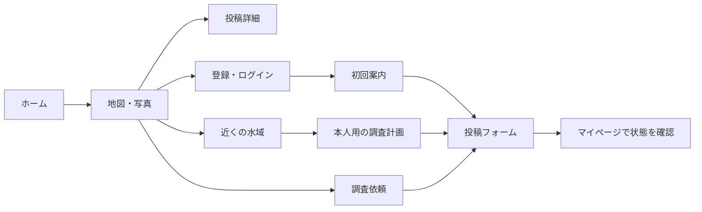

# 画面から分かるザリダス

**見る → 記録する → 振り返る → 次の調査へ進む。** 目的に合う画面から使えます。
このガイドは、画面の役割・開き方・見方・次の操作を説明します。画面内の図は構成と操作の関係を示す模式図です。
2026-10-19のホーム追加に対応しています。細かな現在の契約は各画面の正本を参照してください。

## 初めて使うなら

1. [ホーム](home.md) から参加案内や新着を見て、[地図と写真](map.md) で近くの公開記録を探す。
2. 見つけたことを残す場合は [ログイン・初回案内](account.md) を経て [投稿](posting.md) する。
3. [マイページ](personal.md) で審査状態や送信待ちを確認する。
4. 続けて調べたい場合は [調査依頼](collaboration.md)、[水域探索](water.md)、[本人用の調査計画](fieldwork.md) へ進む。

図は代表的な利用経路です。登録時の案内の要否、本人の状態、入口によって実際の遷移は変わります。

## 何をしたいかで選ぶ

| したいこと | 画面ガイド | 主な入口 |
|---|---|---|
| 参加企画や新着を見る | [ホーム](home.md) | `/` |
| 地域の観察を見る | [地図・写真](map.md) | `/map` |
| 観察を残す・記録の詳細を見る | [投稿・詳細](posting.md) | 投稿操作、`/post/[id]` |
| 登録する・案内を読む・設定する | [認証・初回案内](account.md) | 投稿／マイページ、メニュー |
| 自分の活動と送信待ちを見る | [マイページ・プロフィール・図鑑](personal.md) | `/dashboard`、`/collection` |
| 調査を依頼する・協力する | [調査依頼](collaboration.md) | `/requests`、`/request/[id]` |
| 本人用の場所・計画・希少種を残す | [現地調査](fieldwork.md) | 地図の調査操作 |
| 近くの水辺を探す・水域を知らせる | [水域探索](water.md) | 地図の周辺水域の操作 |
| 傾向を知る・データを入手する | [集計・地域・公開データ](explore-and-data.md) | `/ranking`、`/trends`、`/area`、`/dataset` |
| アプリの説明や利用条件を読む | [紹介・資料・補助画面](information.md) | `/lp`、`/about`、`/species/[species]` など |
| 審査・運営をする | [管理画面](admin.md) | `/admin/login`、`/admin` |

ページのURLと、モーダル・パネルとして開く画面は [全画面一覧](routes.md) にまとめています。

## 閲覧と本人用の操作を区別する

公開記録や集計は閲覧から始められます。投稿・コメント・非公開スポットの保存はログインが必要です。ホームのしおりは端末内に保存します。
管理画面は管理者用。公開プロフィールは本人の公開設定に従います。
地図上の公開位置と、本人が扱う正確な地点は異なります。希少種や個人の調査を公開投稿と同じものとして扱いません。

## 開発者が続けて読むなら

画面の目的はこのガイド、現在の詳細な契約は [docs/current](../current/README.md)、コードの責任と処理は [docs/architecture](../architecture/README.md) を参照してください。
設計の背景は [設計思想と利用体験](../../README/08-design-philosophy.md)、修正の進め方は [参加ガイド](../../CONTRIBUTING.md) へ。
