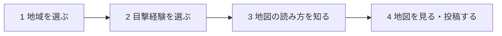

# 認証・初回案内・設定：自分の記録を始める

[画面ガイドへ戻る](README.md)。登録・ログインは、投稿やマイページなどから開くモーダルです。
通常利用者向けの独立した `/login`・`/signup` ページはありません。

## 登録・ログイン

| 開く場面 | 画面ですること |
|---|---|
| 未ログインで投稿・本人用の保存を始める | 登録またはログインを選び、本人として操作できる状態にする |
| メールで登録・ログインする | 入力し、必要な確認メールや認証手続きを進める |
| Googleを使う | Google認証へ進み、認証後にアプリへ戻る |
| パスワードを忘れた | 再設定メールを依頼する |
| 認証メールから戻る | `/auth/callback` で確認・再設定等を処理する |

メール・Google認証・CAPTCHAの利用可否は、運用環境の設定にも依存します。
開発環境で確認する場合は [セットアップ](../../README/03-setup.md) を先に読みます。

## 初回案内は4画面

地域は、最初に見る地図の範囲につながります。
点の意味を説明してから、実際の地図や投稿へ進む構成です。案内の模式図は実際の観察結果ではありません。

| 入口 | 閉じ方と保存の扱い |
|---|---|
| 未ログイン時の誘い・メニューから読む | 任意の案内。あとで読む・今後の誘いを止めることができ、メニューから再表示できる |
| 会員の初回案内 | 未完了の人へ表示。登録直後か既存会員か、保存失敗の状態によって延期の条件が異なる |

任意の案内と会員の案内は、回答の保存先・完了条件が異なります。
案内の回答が、そのまま公開プロフィールに載ることはありません。[詳細な条件](../current/introduction.md)

## 設定はどこで変える？

| 変えたいもの | 入口 |
|---|---|
| 言語・テーマ・地図の設定 | ヘッダーのメニュー |
| 紹介を読み直す | メニューの案内の入口 |
| 表示名・自己紹介・プロフィール公開 | [マイページ](personal.md) のプロフィール編集 |
| メール・Push | プロフィール編集内の通知設定。Pushは端末の許可も必要 |
| 退会 | マイページのアカウント削除。残る記録の扱いを確認して実行する |

ログアウト時に未送信の調査記録があれば、その扱いを確認する画面があります。
同じ端末の別の利用者へ、前の人の下書き・本人用の地点を混ぜないためです。

実装：[AuthModal](../../src/components/modals/AuthModal.tsx)、[OnboardingFlow](../../src/components/onboarding/OnboardingFlow.tsx)、[DrawerMenu](../../src/components/layout/DrawerMenu.tsx)。
コードの説明：[認証](../architecture/authentication.md)、[初回案内](../architecture/authentication-onboarding.md)、[本人設定](../architecture/participation-profile.md)。
