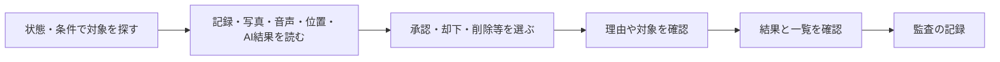

# 管理画面：記録を確認し、運営する

[画面ガイドへ戻る](README.md)。入口は `/admin/login`。管理者として確認された人が利用します。
ログインページに到達できることと、管理者のデータを読めることは別です。

## 目的からページを選ぶ

| URL | 画面 | 何をするか |
|---|---|---|
| `/admin` | 概況 | 期間の指標・最近の投稿・監査などから状況を知る |
| `/admin/posts` | 投稿審査 | 状態・条件で探し、写真・音声・AI結果を見て承認・却下・削除する |
| `/admin/reports` | 通報 | 未対応・対応済みを確認し、必要な投稿対応や通報の解決を行う |
| `/admin/comments` | コメント | 検索、公式コメントの抽出、削除を行う |
| `/admin/users` | 利用者 | 活動や管理権限を確認し、許可された権限変更へ進む |
| `/admin/spots` | 非公開スポット | 調査目的の閲覧・CSV。公開投稿の審査とは分ける |
| `/admin/rare-sightings` | 希少種記録 | 非公開の記録・写真を許可された範囲で確認する |
| `/admin/water-reports` | 水域の情報提供 | 非公開の原票・写真を確認し、公開する名称などを審査する |
| `/admin/logs` | 監査ログ | 操作・期間・管理者などで履歴を見る |
| `/admin/ai-cost` | AI利用 | 期間ごとの利用と費用を確認する |
| `/admin/experiments` | 実験 | 実験群ごとの指標を比較する |
| `/admin/kpi` | 研究指標 | 参加・継続・品質・AI精度などを確認する |

広い画面はサイドバー、狭い画面は主要な項目と「その他」から移動します。
公開アプリのナビゲーションと、運営のメニューは役割が異なります。

## 投稿審査の流れ

AIには条件による自動審査もあります。画面のAI表示を、人が既に確認した記録と同じものには扱いません。
一括処理は成功したものと失敗したものを分けて確認します。選択した全件が必ず成功するわけではありません。
却下理由は本人が見直す手掛かりになります。[審査の現行仕様](../current/moderation.md)

## 閲覧と編集の権限

管理者でも、非公開調査のすべてを自由に書き換えられるわけではありません。
本人用の計画・希少種には、管理者の閲覧・削除と本人の作成・編集を分ける契約があります。
管理用の正確位置やCSVは、一般公開用データとは異なります。

取得できなかった指標は実測0と区別します。無操作が続いた場合は警告・ログアウトの仕組みがあります。
権限は画面の表示だけで決めず、サーバーとDBでも確認します。[認可の設計](../architecture/authorization.md)

実装：[管理ページ本体](../../src/views/admin/)、[保護レイアウト](<../../src/app/admin/(protected)/layout.tsx>)、[希少種管理](../../src/features/fieldwork/admin/)、[水域管理](../../src/features/water/admin/AdminWaterReportsView.tsx)。
詳しい説明：[管理画面の設計](../architecture/frontend-admin.md)、[通知とAI](../architecture/notifications-ai.md)。
