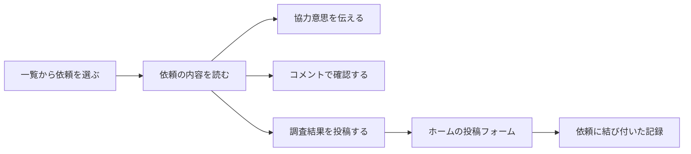

# 調査依頼：調べてほしい場所を共有する

[画面ガイドへ戻る](README.md)。一覧は `/requests`、一つの依頼は `/request/[id]` です。
観察の投稿は「得られた記録」、調査依頼は「ここを調べてほしい」という呼びかけです。

## 一覧から探す

一覧では、状態・生きもの・市町村・自分の依頼などで絞り、並び順を選びます。
条件はURLにも反映するため、同じ条件へ戻ったり、リンクを共有したりできます。
依頼を選ぶと詳細へ進みます。新しい依頼は一覧の作成操作や `/requests?create=1` から始めます。

| 画面 | 表示・入力するもの | 次の操作 |
|---|---|---|
| 依頼一覧 | 場所、対象、状態、緊急度などの要約 | 条件で探し、詳細を開く |
| 作成フォーム | 位置、市町村、生きもの、理由、緊急度 | ログインして依頼を保存する |
| 依頼詳細 | 理由、場所、協力者、コメント、関連する承認済み投稿 | 協力、会話、結果投稿へ進む |

何がいるか分からない段階でも依頼できます。結果を投稿するときは、観察した対象を選びます。

## 協力するときの流れ

協力意思、コメント、観察結果は別々に表示します。
「協力する」を押したこと自体は、現地へ行った・観察を終えたという意味ではありません。
結果投稿は、依頼の対象や公開位置などをフォームへ引き継ぎます。

## 依頼した本人の操作

本人には、依頼を終了する操作が表示されます。確認してから終了します。
紐付いた投稿による状態の変化は、本人が先に「結果あり」に設定する操作とは別です。
コメントの削除なども、自分に許された操作だけを行います。

## 使い分け

| 機能 | 目的 |
|---|---|
| 調査依頼 | ほかの人へ調査を呼びかける |
| [本人用の調査計画](fieldwork.md) | 自分の予定と立寄り先を組む |
| [観察の投稿](posting.md) | 実際に得た記録を残す |

公開位置は粗化されています。画面の位置から、立入りや安全を保証するものではありません。
取得に失敗した場合は再試行し、通信失敗を「依頼がない」と読み替えないようにします。

実装：[依頼一覧](../../src/views/SurveyRequestsListPage.tsx)、[依頼詳細](../../src/views/SurveyRequestPage.tsx)、[作成フォーム](../../src/components/modals/SurveyRequestForm.tsx)。
詳しい設計：[調査依頼UI](../architecture/participation-surveys.md)、現在の契約：[調査依頼](../current/survey-requests.md)。
