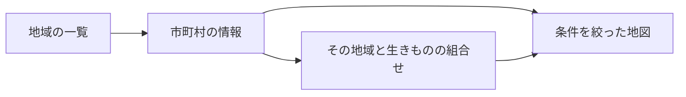

# 集計・地域・公開データ：一つの記録から全体を見る

[画面ガイドへ戻る](README.md)。記録を一覧で見るだけでなく、貢献の広がりや地域の傾向を読む画面です。

## ランキング `/ranking`

| 表示 | 何を見るか |
|---|---|
| 多様性 | 記録の種類・地域など、観察の広がりを見る。最初に表示するタブ |
| 品質 | 記録の品質に関わる指標を見る |
| 投稿数 | 期間を選んで件数を比較する |

件数だけを先に見せない構成です。何が評価されているかを、表示中のタブと併せて読んでください。
比較表示の対象はプロフィールの公開設定などに従います。本人の管理画面とは異なります。

## 推移・統計 `/trends`

月別の推移、種・情報種別・地域などの内訳をグラフや指標で確認します。
ホームで一つずつ記録を追う場合と、地域全体の傾向を読む場合を分けています。
小さな標本や期間の違いにも注意し、投稿件数をそのまま生息数として読まないようにします。

## 地域の入口 `/area`

`/area/[municipality]` は地域の入口、`/area/[municipality]/[species]` は対象種まで絞った入口です。
地域や種を探す人が、地図・記録へ進めるようにしています。内部パラメータは一覧のリンクから選べます。

## 公開データ `/dataset`

公開用データの範囲・引用・入手方法を説明し、CSV・GeoJSONのダウンロードへつなぎます。

| データ | 用途と扱い |
|---|---|
| 公開CSV・GeoJSON | 承認済み投稿を公開用の列と粗化位置で配布する |
| マイページのCSV | 本人の振り返り・手元の整理に使う。公開データとは列や対象が異なる |
| 管理者のCSV | 運営・研究で許可された範囲を扱う。一般公開用として再配布しない |

公開データには、メール・IP・自由記述・写真などを含めません。公開用の位置は小数3桁へそろえます。
コードのMITとデータのCC BY 4.0は別の条件です。スナップショットの確認・登録・引用は [公開手順](../runbooks/open-data-doi.md) に従います。
画面の説明だけで、取得件数の完全性や実際の配布状況を判断しないでください。[取得の制約](../architecture/dataset-surveys.md)

## 次に読む

観察した生きもの自体を知りたい場合は [種の説明](information.md)、自分の活動は [マイページ](personal.md) へ進みます。
実装：[RankingPage](../../src/views/RankingPage.tsx)、[TrendsPage](../../src/views/TrendsPage.tsx)、[AreaListPage](../../src/views/AreaListPage.tsx)、[dataset](../../src/app/dataset/page.tsx)。
詳しい設計：[参加と集計](../architecture/participation.md)、[公開ページ](../architecture/localization-ui-seo.md)、[公開データ](../architecture/dataset-surveys.md)。
