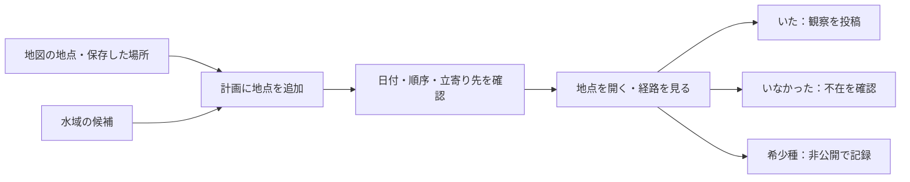

# 現地調査：本人用の場所・予定・結果をつなぐ

[画面ガイドへ戻る](README.md)。独立したURLのページではなく、ホームの地図上で開くパネルやシートです。
ログインした本人が、自分の調査を管理します。

## まず、3つを区別する

| 使うもの | 何を残すか |
|---|---|
| 一時ピン | 地図で今選んでいる地点。保存済みの記録とは別 |
| 非公開スポット | 後で使いたい、名前付きの本人用の場所 |
| 調査計画 | 日付・順序・立寄り先・結果を持つ予定 |

非公開スポットは、ほかの利用者の公開地図へそのまま出す機能ではありません。
本人用の情報は、業務上許可された管理者の閲覧経路とは区別します。

## 地点から計画を作る

外部地図の経路は、選んだ地点まで移動する補助です。非公開地点の名前やメモを共有する操作とは異なります。
計画へ追加する位置と、公開地図に表示される粗い位置の違いを確認してください。

## 調査パネルの見方

| 要素 | 何をするか |
|---|---|
| 計画のタブ | 計画を選び、地点・順番・訪問状態を確認する |
| 希少種のタブ | 本人の非公開な希少種記録を扱う |
| 地点のシート | 地点の状態を変え、いた／いなかった等の記録へ進む |
| 送信待ち | 通信後に送る作業と、再試行・破棄の対象を確認する |
| 地図上の印 | 計画の地点や、本人が表示を選んだ希少種の印を見る |

不在確認は「調べて見つからなかった」を本人が明示して残す操作です。
現在地の条件に応じて使う位置を示し、対象を確認してから記録します。地図に点が無いだけで自動作成されません。

## 希少種を扱うとき

希少種は通常の公開投稿と分け、位置・観察・必要な写真を非公開の記録として扱います。
近くの本人の投稿を位置非公開へ寄せる保護もあります。地図の印をOFFにしても、保護処理は別に働きます。
管理者による調査目的の閲覧はあります。正確な位置を、公開用のCSVや地図へ持ち込まないことが前提です。

## 圏外で見えるもの・送信するもの

同期済みの計画の控えと、未送信の結果を区別します。圏外で計画を自由に編集できるわけではありません。
作業の種類によって送信待ちを持ち、通信が戻ったら続きを送ります。
ログアウト時は未送信の扱いを確認します。端末のデータを、別の人の調査として送らないためです。

実装：[FieldworkPanel](../../src/features/fieldwork/components/FieldworkPanel.tsx)、[StopSheet](../../src/features/fieldwork/components/StopSheet.tsx)、[RareSightingSheet](../../src/features/fieldwork/components/RareSightingSheet.tsx)。
詳細な条件は [現行仕様](../current/fieldwork.md)、保存と保護の設計は [fieldwork](../architecture/fieldwork.md) を参照してください。
