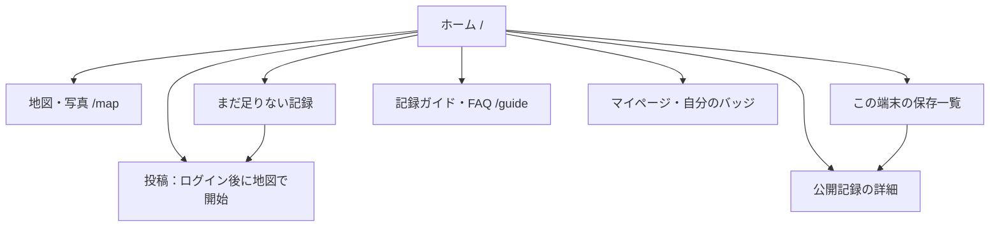

# ホーム：見ることと、参加することを選ぶ

[画面ガイドへ戻る](README.md)。アプリを開いた直後の `/` がホームです。

## 最初にできること

- 未ログインでは、最上部の説明で「何のサービスか」を読み、「無料で登録して記録する」か「登録せずに地図を見る」を選びます。
- 上のバナーで参加企画・アンケート・アプリの紹介を見る。矢印で3つを切り替えます。1枚目は「記録する」へ進みます（未ログインでは登録の小窓が開きます）。
- 「地図」で地域の記録を探す。「投稿」で自分の観察を残す。投稿にはログインが必要です。
- ログイン中は、自分のXP・承認された記録・見つけた種類・バッジを確認できます。
- 登録・ログインのあとは、ホームに戻ります（投稿画面は自動で開きません）。
- 登録・ログインの小窓のタブは「ログイン」と「新規登録」です。パスワードを忘れたときは、ログインの「パスワードを忘れた方」から再設定に進みます。
- ページの末尾に、このサービスについて・利用規約・プライバシーポリシー・お問合せのリンクがあります。上のほうの「記録の使われ方・連絡先」も同じ説明ページへ行きます。
- 読み込めなかったときは「再試行」を選びます。取得失敗と0件を区別します。

## 一覧の読み方

| 欄 | 何が分かるか |
|---|---|
| ピックアップ・新着の記録 | 最近の承認された公開記録。ピックアップに出した記録は新着には出ません。写真なしの記録は1行で並びます |
| まだ足りない記録 | 記録がまだ少ない種・「見つからなかった」・市町村の数字（公開記録を数えたもの）。押すと記録を始められます |
| 人気の記録 | いいねが付いた記録が3件以上になると出ます。直近の取得分をいいね順に表示（全期間の順位ではありません） |
| 新着のしつもん | 質問が付くと出ます。開くとその記録の会話へ進みます |
| 図鑑 | 対象の生き物の説明。自分の図鑑は下部ナビから開きます |
| 記録ガイド・お知らせ | 記録方法、よくある質問、運営からの参加案内 |

水辺や生き物の画像に「説明用の画像」の札があるものは、生成した案内用の画像です。公開された記録の写真には付きません。
投稿のしおりボタンで、最大200件をこの端末のブラウザに保存できます。
「保存した記録を見る」は保存があるときに出て、不要なら解除します。別の端末には同期しません。
非公開になった記録や削除された記録は表示されません。

スマホでは下部の5つのタブ、PCのホームでは左のナビを使います。
動向・ランキング・調査依頼はメニューから開けます。[地図の使い方](map.md)

実装：[HomeHub](../../src/components/features/home/HomeHub.tsx)。契約：[ホームの仕様](../current/home.md)。
