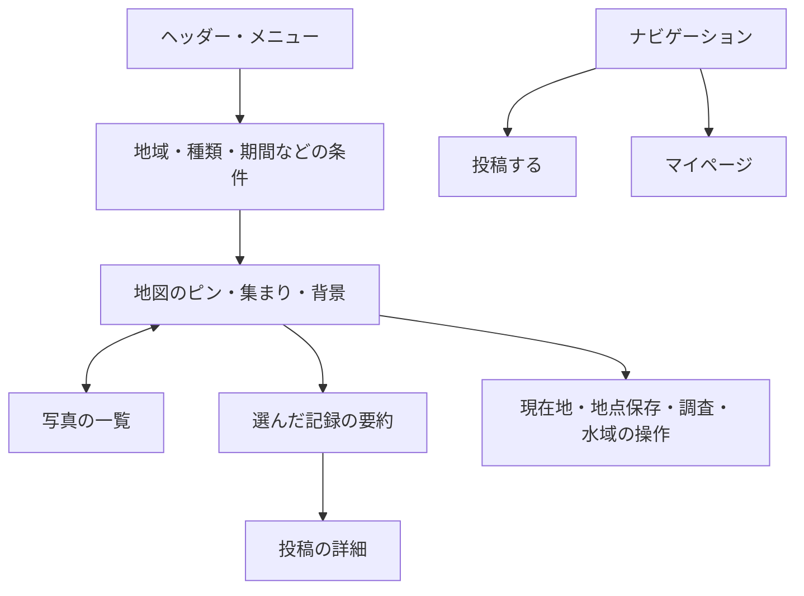

# 地図と写真：近くの記録を探す

[画面ガイドへ戻る](README.md)。入口はナビの「地図」 `/map`。まず公開記録を知りたい人の画面です。

## どんな場面で使う？

「この辺りで、何が記録されているか」を地図から探します。
写真を見比べたい場合は、同じ地図画面内の写真表示へ切り替えます。

## 画面の見方

| 要素 | 読み取ること |
|---|---|
| 条件の選択 | 表示したい地域・生きもの・期間・記録の種類を絞る |
| 地図のピン | 公開できる位置の記録。種は色だけでなく形などでも区別する |
| ピンのまとまり | 近い位置の記録が集まっていることを示す |
| 写真の一覧 | 取得した記録を写真から探す。選ぶと詳細へ進む |
| 地図上の操作 | 現在地、本人用の地点、調査パネル、水域探索を開く |
| メニュー | 背景・表示設定、言語、テーマ、案内や各ページへの入口 |

## 一つの記録を見る

1. 地域や条件を選び、見たい範囲へ地図を動かす。
2. ピン、まとまり、または写真を選ぶ。
3. 要約から [投稿詳細](posting.md) を開き、日時・写真・記録内容を読む。

地図と写真は同じ `/map` 内の表示です。別のURLへ移動する切替とは異なります。
狭い画面では下部ナビゲーション、広い画面ではヘッダーのナビゲーションを使います。

## 現在地を追いかける

右下の矢印ボタン（現在地を表示）を押すと、青い点が自分の位置を表し、移動に合わせて動きます。地図の中心も現在地に保たれます。

- 地図を指で動かすと、追従だけが止まります。青い点は動き続けます。ボタンを押すと現在地へ戻って、追従を再開します。
- 追従中にボタンを押すと止まり、青い点が消えます。
- 位置が来るまで時間がかかるときは、ボタンの左に「現在地を取得しています…」と出ます（10秒を超えると「時間がかかっています」に変わります）。追従を始めた最初の1回は「もう一度押すと止まります」、地図を動かして一時停止になった最初の1回は「このボタンで現在地に戻ります」と出ます。位置を待つあいだに地図を動かすと、位置が届いても地図は引き戻されず、一時停止になります。
- 位置を取っているあいだは、対応する端末で画面が消えないようにします。ブラウザを閉じたり、ほかのアプリへ切り替えたりすると取得は止まり、戻ると再開します。
- 追従のために取った位置を、当サイトが自動で送ることはありません。「近くの水域を探す」や「非公開で保存」、投稿など、あなたが押した機能は、その機能に必要な座標を使います。追従中は、地図の範囲が現在地を示してしまうので、「現在の地図範囲内のみ」の絞り込みがオフになります。
- 地図の背景画像は、表示している地域の分を提供元から取ります。追従中は現在地の周辺の地域が提供元に伝わります（手で動かしたときと同じです）。

## 見つけた場所から記録する

地図で一時的に置いた地点から投稿を始めると、その位置をフォームへ引き継ぎます。
後で使う場所なら [本人用のスポット](fieldwork.md)、水辺を探すなら [水域探索](water.md) へ進みます。
投稿する場合、未ログインなら認証を経ます。[認証と案内](account.md)

## 読み違えないために

- 公開位置は粗化されている場合があります。表示の点を、常に観察した正確な地点とは考えません。
- 位置非公開の記録は地図上に出ません。空白の場所が「生息していない」ことを示すわけではありません。
- 取得エラーの表示がある場合は再試行します。通信失敗と「条件に合う記録が0件」は別です。
- ヒートマップは公開記録に基づく表示です。生息密度をそのまま測った地図ではありません。

実装：[HomePage](../../src/views/HomePage.tsx)、[MapView](../../src/components/features/map/MapView.tsx)、[現在地の追従](../../src/components/features/map/LocateControl.tsx)、[写真一覧](../../src/components/features/posts/PhotoGallery.tsx)。
設計の詳しい説明：[地図・一覧・非公開スポット](../architecture/map-posts.md)。
