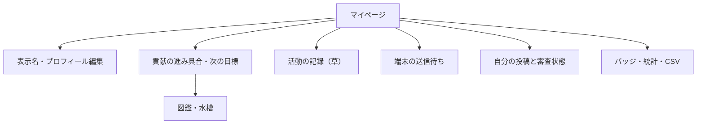

# マイページ・プロフィール・図鑑：活動を振り返る

[画面ガイドへ戻る](README.md)。自分の活動は `/dashboard`、図鑑は `/collection`、公開プロフィールは `/profile/[userId]` です。

## マイページで確認すること

ログインした本人の投稿・設定・送信待ちをまとめます。
`/profile` や自分のプロフィールURLを開いた場合も、本人の管理はマイページへつながります。

| 見る場所 | 何が分かる・何ができる |
|---|---|
| プロフィール | 表示名・紹介・公開可否の編集へ進む |
| 貢献の表示 | レベルやXP、次に使える任意機能、観察の広がりを見る |
| 活動の記録 | 過去1年に記録を投稿した日が、濃さで見える。日を選ぶと件数と内訳が出る。本人だけに表示 |
| 送信待ち | 端末に残る下書きを確認し、送る・破棄する |
| 自分の投稿 | 審査待ち・承認・却下などを確認し、詳細・編集・削除へ進む |
| 却下理由・品質の助言 | 記録を見直す手掛かりを読む |
| バッジ・統計・CSV | 活動を振り返り、用途に応じて書き出す |
| アカウント管理 | メール確認や退会など、本人の手続きへ進む |

投稿を送った直後に、承認済み件数や貢献が必ず増えるわけではありません。
「活動の記録」は、審査待ちの記録も投稿した日に数えます（却下された記録は数えません。審査待ちが後で却下されると、その日の草は消えます）。
送信待ち、保存済み、承認済みはそれぞれ別の状態です。

## プロフィール編集と公開プロフィール

編集はマイページ内のモーダルです。表示名・紹介・絵文字・公開可否、メールやPushの設定を扱います。
メールとPushは別の設定で、Pushにはブラウザ・端末の対応と許可が必要です。

`/profile/[userId]` は、公開している人の紹介・活動・バッジを見る画面です。
本人のメール・通知設定を表示するページではありません。非公開や該当なしは、取得エラーと区別します。

## 図鑑と水槽

`/collection` はログインした本人の画面です。進行条件に届く前は解放予告を表示します。
使えるようになると、学習上の説明、水槽、種ごとの図鑑が並びます。
承認された観察から、記録の種類や観察地域の広がりを振り返れます。
3Dの表示は対応端末で「3Dで見る」から開きます。3D表示が観察や投稿の必須条件になるわけではありません。

## なぜ、このまとまりなのか

日々見る投稿履歴と進み具合を先に置き、統計やCSVは必要なときに開く構成です。
公開プロフィールと本人の管理を分けることで、見せたい活動と本人用の設定を混ぜません。
貢献の意味や計算は [現行仕様](../current/gamification.md) を参照してください。

実装：[DashboardPage](../../src/views/DashboardPage.tsx)、[ProfilePage](../../src/views/ProfilePage.tsx)、[CollectionPage](../../src/views/CollectionPage.tsx)。
コードの説明：[参加を支えるUI](../architecture/participation.md)、[本人設定](../architecture/participation-profile.md)。
