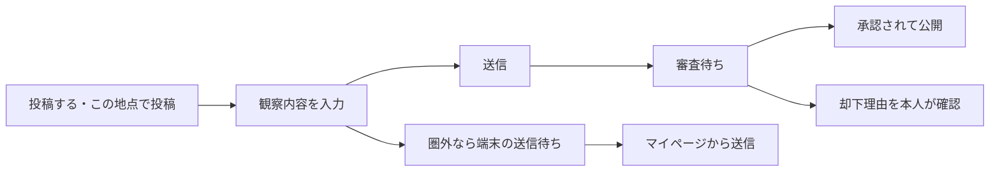

# 投稿と詳細：観察を残し、内容を確認する

[画面ガイドへ戻る](README.md)。投稿はホーム等の操作から開くフォーム、詳細は `/post/[id]` です。
投稿用の独立した `/post/new` ページはありません。

## 投稿フォームで何をする？

ログインして、見つけたこと・調べたことを記録します。写真や音声は観察内容を伝える手掛かりになります。

| 入力する内容 | 意味 |
|---|---|
| 生きもの・情報の種類 | 何を、どのような観察として残すか |
| 場所・観察日時 | いつ・どこでの記録か。地図で選んだ地点を引き継ぐ入口もある |
| 写真・音声 | 形や鳴き声などを伝える添付。入力条件は生きものや記録に応じる |
| 個体数・調査の情報 | 記録の数量や、調べた方法・時間など |
| コメント・公開の設定 | 観察の補足と、投稿者・位置の見せ方 |

位置の非公開と、投稿者名を匿名表示にする設定は別です。匿名表示でも投稿にはログインが必要です。

保存、審査、公開は別の段階です。管理者または条件を満たすAI判定が審査状態を更新します。
端末の送信待ちは、サーバー保存の完了ではありません。[マイページ](personal.md) で確認してください。

## 投稿詳細では何が分かる？

詳細は、地図の要約・写真・投稿履歴などから開きます。

| 表示・操作 | 役割 |
|---|---|
| 生きもの・情報種別・観察日時 | 一つの観察を詳しく読む |
| 写真・音声・観察内容 | 記録の内容を確認する。写真は拡大し、音声は再生する |
| 位置・周辺情報 | 公開できる範囲の位置を見る。本人用の正確な位置とは分かれる |
| AI判定・品質の助言 | 判定や、記録を見直す手掛かりを確認する。内容によって表示が変わる |
| コメント・いいね | 記録についてやり取りする。書き込みはログイン後 |
| 共有 | X・LINE、端末の共有機能、リンクコピーを使う |
| 本人の編集・削除・位置非公開 | 自分の記録を管理する。公開へ戻す操作は管理者側の扱い |
| 通報 | 問題がある記録を運営へ知らせる |

未承認の投稿をURLさえ知っていれば誰でも見られる、という仕様ではありません。
本人と公開閲覧では、見られる状態・位置・操作が異なります。[公開範囲](../current/privacy.md)

## 次に進む

投稿した後は [マイページ](personal.md) で状態を確認します。
調査依頼から記録した場合は [依頼の詳細](collaboration.md)、調査地点からなら [計画](fieldwork.md) の結果にもつながります。

実装：[PostForm](../../src/components/features/posts/PostForm.tsx)、[DetailPage](../../src/views/DetailPage.tsx)。
詳しい設計：[入力とメディア](../architecture/map-posts-media.md)、[詳細と交流](../architecture/map-posts-detail.md)、[保存と審査](../architecture/posting-moderation.md)。
