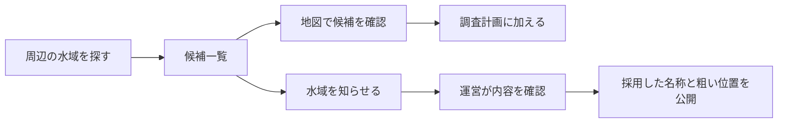

# 水域探索：次に調べる水辺を探す

[画面ガイドへ戻る](README.md)。ホームの地図から開く一覧・地図レイヤー・情報提供フォームです。
独立した `/water` ページはありません。

## 検索から調査へ

地図で周辺の水域を探すと、取得した候補を一覧と形で確認できます。
候補を選んで位置を見たり、本人用の調査計画へ加えたりします。

## 一覧の見方

| 要素 | 意味 |
|---|---|
| 水域名・位置 | 外部地理データや、採用された情報提供に由来する候補 |
| 距離 | 検索時の地点から水面・岸までの目安。道路の経路距離ではない |
| 公開記録数 | その水域周辺の公開位置に対応する記録。完全に取得できた場合に件数を示す |
| 記録のない候補を選ぶ操作 | 公開記録が確認できない候補から、次に見る場所を選ぶ補助 |
| 「計画に追加」 | 選んだ候補を [本人の調査](fieldwork.md) へ渡す |
| 「水域を知らせる」 | 地図に不足する水辺などを写真付きで運営へ知らせる |

**公開記録が0件でも、未調査や生息していないことを証明しません。**
公開位置の粗化・非公開記録・取得上限があるためです。件数が不明な状態も、0件とは区別します。
候補の地図は、進入できる場所や現地の安全を保証する案内ではありません。

## 水域を知らせるフォーム

ログインして、選択した位置、名称、写真1〜3枚、必要ならメモを送ります。
送信した原票と写真は非公開で、運営が内容を確認します。
採用されると、確認済みの名称と粗化した位置を公開側へ反映します。原票の写真やメモをそのまま公開する処理ではありません。

送信が途切れた場合は、同じ提出として再試行できるように状態を持ちます。
アカウントを切り替えた後の処理を、別の人の情報提供として表示しないようにしています。

## 待機・失敗の表示

検索中、候補が無い、取得に失敗した、記録数を確定できない状態を分けて読みます。
計算のためにWorkerやRust/Wasmを使う場合がありますが、利用者が個別にインストールする操作はありません。
取得や計算の仕組みは [水域設計](../architecture/water-geometry.md) にまとめています。

実装：[NearbyWaterPanel](../../src/features/water/components/NearbyWaterPanel.tsx)、[NearbyWaterLayer](../../src/features/water/components/NearbyWaterLayer.tsx)、[WaterReportSheet](../../src/features/water/WaterReportSheet.tsx)。
運営側の確認は [管理画面](admin.md) を参照してください。
